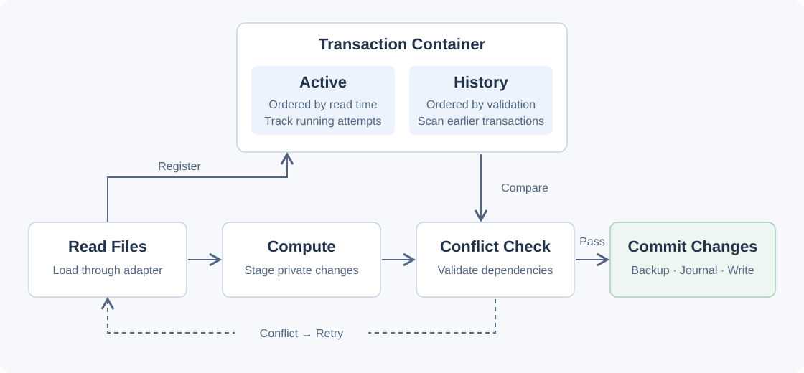

[](https://github.com/mbb200291/go-occ-z/actions/workflows/test.yml) <!-- pohw-badges:start -->
[](https://github.com/mbb200291/go-occ-z/blob/pohw-badges/REPORT.md) [](https://github.com/mbb200291/go-occ-z/blob/pohw-badges/REPORT.md)
<!-- pohw-badges:end -->

# go-occ-z

- Optimistic concurrency control for Go, using backward validation.
  Based on [CMU Lecture #18](https://15445.courses.cs.cmu.edu/fall2024/schedule.html).
- Journal files and backups support transaction rollback and recovery.

Early release. Production use requires further validation.

## How it works



Transactions read data, compute private changes, check for conflicts, and commit.
The containers track active attempts and earlier transactions. Reads happen on
demand during computation. Conflicts retry with fresh state.

[Architecture details](docs/architecture.md)

## Quick start

```sh
go get github.com/mbb200291/go-occ-z/occ
```

Requires Go 1.25 or newer.

Implement a `TargetAdapter` for storage and a `Command` for each operation.
Share one manager across goroutines. Each `Run` executes its commands as one transaction.

This example runs two XOR commands concurrently on an existing `bit` target.
The adapter stores it as a `uint8`, initially `0`. After both transactions succeed,
its value is `0 ^ 1 ^ 1 = 0`.

```go
import (
    "errors"
    "fmt"

    "github.com/mbb200291/go-occ-z/occ"
)

type XOR struct {
    Target string
    Mask   uint8
}

func (c XOR) Execute(ctx occ.Context) (any, error) {
    data, err := ctx.GetData(c.Target)
    if err != nil {
        return nil, err
    }
    value, ok := data.(uint8)
    if !ok {
        return nil, fmt.Errorf("target %q: expected uint8", c.Target)
    }
    value ^= c.Mask
    ctx.SetData(c.Target, value)
    return value, nil
}

func xorTwice(adapter occ.TargetAdapter) error {
    manager, err := occ.NewManager(adapter)
    if err != nil {
        return err
    }
    done := make(chan error, 2)
    for range 2 {
        go func() {
            _, err := manager.Run([]occ.Command{XOR{Target: "bit", Mask: 1}})
            done <- err
        }()
    }
    return errors.Join(<-done, <-done) // Wait for both transactions.
}
```

Each goroutine starts a separate transaction. If they conflict, OCC retries.
Commands passed together to a single `Run` execute sequentially in one transaction.

### Context during execution

Inside `Execute`, use Context for all transaction reads and writes:

| Method | Behavior |
| --- | --- |
| `GetData(target)` | Reads through the adapter when no private value exists. A successful read adds the target to the read set. |
| `SetData(target, value)` | Stores a private value and adds the target to the write set. Storage changes during commit, after validation. |

Later reads return the private value, including staged writes. Calling `SetData`
first does not read the original value. Targets can be chosen during execution.

Commands in one `Run` share a Context. Retries get a fresh one. Use it only during
`Execute`, propagate read errors, and write only to existing targets.

## Implement Command

Implement `Execute`, as shown by `XOR` above:

```go
type Command interface {
    Execute(ctx occ.Context) (any, error)
}

var _ occ.Command = XOR{}
```

- Return an outcome or `nil`. `Run` returns successful outcomes in command order.
- Propagate errors. Commands may retry, so keep transaction data in Context
  and avoid external side effects.
- Shared command instances must be safe for concurrent use.

## Implement TargetAdapter

```go
type TargetAdapter interface {
    Read(target string) (any, error)
    Write(target string, value any) error
    Serialize(value any) ([]byte, error)
    UnSerialize(data []byte) (any, error)
}
```

- Use a consistent key for each target. `Read` must copy mutable data, including
  nested maps and slices.
- Methods must support concurrent calls. Writes must preserve unrelated targets
  and finish the required storage flush before returning success.
- If `Write` retains mutable input, keep a copy separate from the returned outcome.
- `Write` handles commit and rollback. Serialization must preserve values across restarts.

## Options

Validation conflicts retry automatically, then fall back to one exclusive attempt.
Command and storage errors are returned without retrying. Use `manager.RunExclusive(commands)`
to wait for active calls and execute exclusively from the start.

Defaults: 32 retries, 1ms initial delay, 100ms maximum delay, jitter off.
To override them, pass an optional config (import `time`):

```go
manager, err := occ.NewManager(adapter, occ.Config{
    Retry: &occ.RetryOptions{
        MaxRetries: 5,
        BaseDelay:  time.Millisecond,
        MaxDelay:   100 * time.Millisecond,
        Jitter:     true,
    },
})
```

Provide all numeric fields when overriding. `MaxRetries: 0` goes straight to the
exclusive attempt after the first conflict. Delays require `0 < BaseDelay <= MaxDelay`.

## Notes

- Transactions support updates to existing targets only.
- Use Context only during `Execute` and let OCC manage its dependency sets.
  Keep calls to the manager outside commands.
- Keep `.occ`, the working directory, and its associated storage intact.
  One manager owns each `.occ` directory until process exit.
  A second manager gets `ErrDirectoryInUse`.
- Locks are per directory. Ensure a single manager owns the underlying data.

## Errors and recovery

Use `errors.Is` for public errors and the underlying adapter/command error.
`ErrIniManager` covers configuration, directory locking, and startup recovery.
`ErrIniTxn` covers empty command lists and nil commands. Adapters and commands
must have non-nil values, including their underlying pointers.

Command errors return `ErrExecute` without commit. Read errors propagated from
`Context.GetData` also carry `ErrRead`. Commit failures trigger rollback and
normally return `ErrCommit`. Rollback failure **panics** with `ErrRollback`. Stop
the process and recover on restart before serving more transactions.

Cleanup failures are logged and retried at startup. Transaction records are
removed after completion. Keep a separate history if needed.
File contents are synced, while parent directory synchronization remains pending.
Power-loss durability requires further work. External readers may see intermediate writes.

### Handling a rollback panic

On rollback panic, exit and let your service manager restart the process.
`NewManager` runs recovery at startup. Preserve `.occ`, the working directory,
storage, and adapter serialization format. The old manager holds its lock until exit.

```go
// Imports: errors, log, os, and github.com/mbb200291/go-occ-z/occ.
func runOrExit(mgr occ.Manager, cmds []occ.Command) ([]any, error) {
    defer func() {
        if p := recover(); p != nil {
            if err, ok := p.(error); ok && errors.Is(err, occ.ErrRollback) {
                log.Printf("rollback failed. Exiting for startup recovery: %v", err)
                os.Exit(1)
            }
            panic(p)
        }
    }()
    return mgr.Run(cmds)
}

func start(adapter occ.TargetAdapter, cmds []occ.Command) ([]any, error) {
    // Call once at startup. NewManager completes recovery before returning.
    mgr, err := occ.NewManager(adapter)
    if err != nil {
        return nil, err
    }
    return runOrExit(mgr, cmds)
}
```

Call `runOrExit` in each transaction goroutine. `os.Exit` stops the process and
skips deferred functions. Ordinary errors return to the caller, who also decides
whether to resubmit requests after recovery.

## Tests

```sh
go test -race -count=1 -timeout=5m ./...
go vet ./...
```

## Benchmark


An 8 × 8 matrix, one file per target, 20 requests, 20 workers, and a simulated
100ms wait per attempt. X shows the read/write ratio. Y shows target coverage per
request. Values are median sequential time / median parallel time across five runs.
Above 1 means faster. The baseline uses the same OCC Manager with one worker.

[Results, raw data, and configuration](https://github.com/mbb200291/go-occ-z-usecase/tree/main/matrix-demo/benchmark-results/2026-10-31-delay100ms-workers20).

[Architecture](docs/architecture.md) · [Release notes](CHANGELOG.md) · [MIT license](LICENSE)
