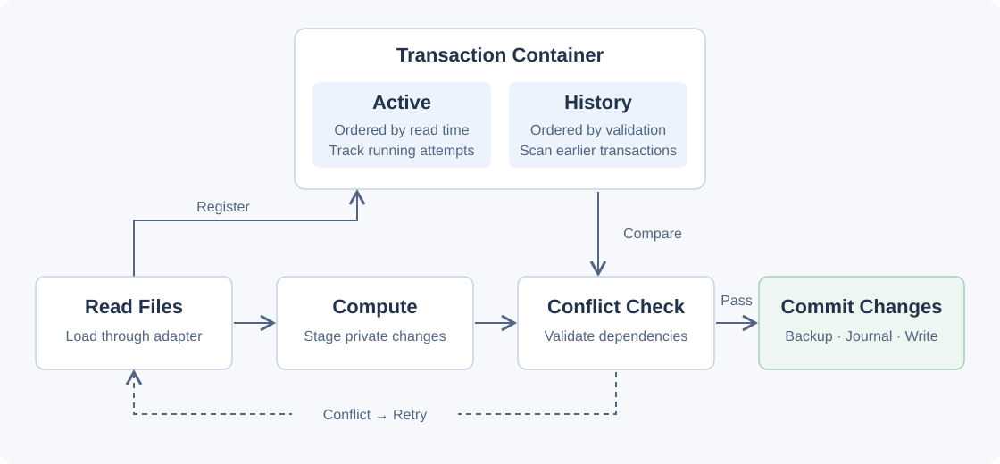
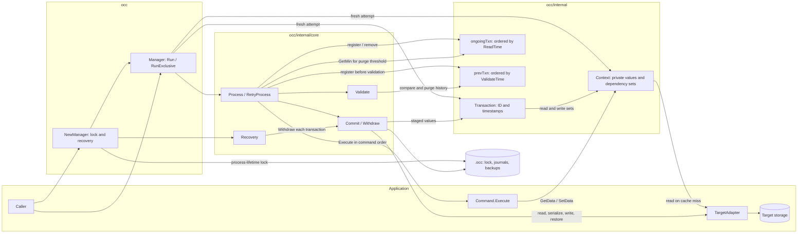
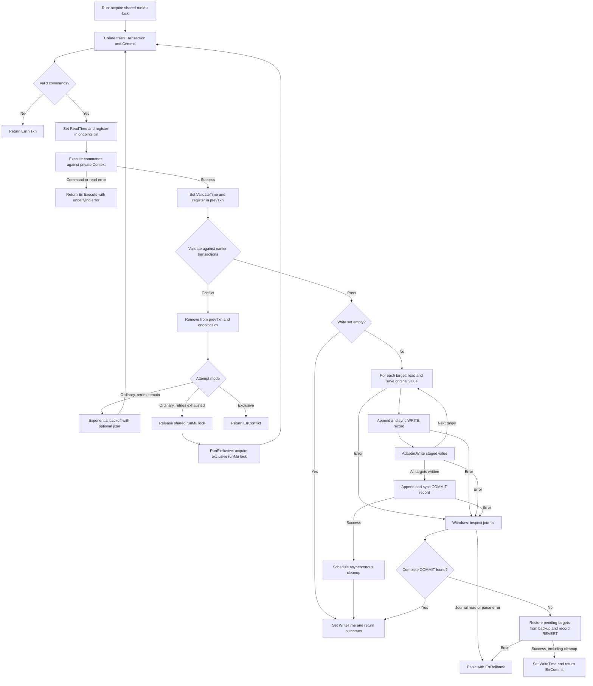

# OCC architecture

The diagrams follow the current `dev` implementation. The observer extension is
published separately as `v0.1.0-observe.1`.

The overview groups two ordered containers under Transaction Container. Reading
and computation are shown separately for clarity. Commands load data on demand
through Context. Registration in Active occurs before reads, and registration in
History occurs before validation.

## Components

- `GetData` caches successful storage reads and records their targets in the read
  set. `SetData` stages values and adds targets to the write set. The adapter must
  return independent mutable data.
- `ongoingTxn` contains attempts from ReadTime registration until `Process` exits.
  `prevTxn` contains validating attempts and retained completed history. A conflict
  removes its own entry. Validation purges visited entries whose WriteTime is
  earlier than every ongoing ReadTime.
- `runMu.RLock` lets ordinary `Run` calls overlap, including their retries.
  `RunExclusive` uses `runMu.Lock` for one attempt. The short `muR` and `muV`
  critical sections protect timestamp allocation and registration. Validation
  and commit run after those locks are released.

## Transaction flow

Each attempt removes itself from `ongoingTxn` when `Process` exits, including
error and panic paths. The diagram shows that removal explicitly on the retry
path. Returning or panicking also releases the manager's run lock.

ReadTime marks the start of the attempt, before storage reads. ValidateTime is set
after private execution. WriteTime stays at a sentinel value until writes or
rollback finish. Read-only success also sets WriteTime.

Only a bare `ErrConflict` triggers retry. The same Command objects execute again
with fresh transaction state. The exclusive fallback executes once. Successful
outcomes are returned in command order.

### Journal and recovery

Each transaction uses `.occ/<txn-id>/journal` and `.occ/<txn-id>/backup/`.
Commit processes one target at a time: backup, WRITE record, then adapter write.
After all targets are written, it records COMMIT and schedules cleanup.

`Withdraw` preserves data when it finds a complete COMMIT record. Otherwise it
restores targets with outstanding WRITE records, appends REVERT, and cleans up.
An incomplete journal suffix is truncated before appending recovery records.
Directories with no journal are also cleaned up. If COMMIT is found after a
commit error, `Process` returns success even if cleanup needs another attempt.

At startup, `NewManager` acquires the `.occ` lock and runs `Recovery`, which calls
`Withdraw` for each transaction directory. Initialization errors release the lock.
A successfully initialized manager retains it until process exit. After a rollback
panic, restart with the same storage and working directory to run recovery.

The adapter controls storage writes and flushing. Core syncs backup and journal
files. Parent directory synchronization remains pending, so power-loss durability
requires further work.

## Source

- [Manager and configuration](../occ/main.go)
- [Private Context](../occ/internal/context.go)
- [Transaction state](../occ/internal/transaction.go)
- [Execution and retries](../occ/internal/core/process.go)
- [Validation and history cleanup](../occ/internal/core/validate.go)
- [Commit, rollback, and recovery](../occ/internal/core/commit.go)
- [Directory ownership lock](../occ/lock.go)
